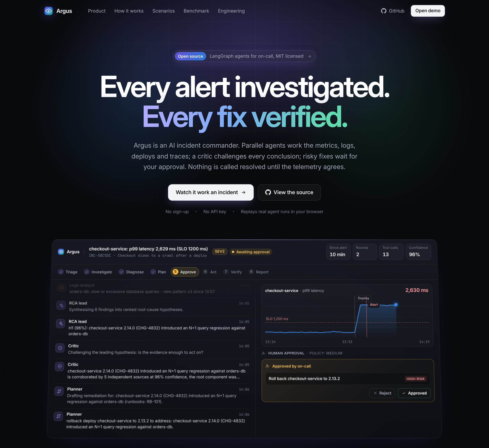
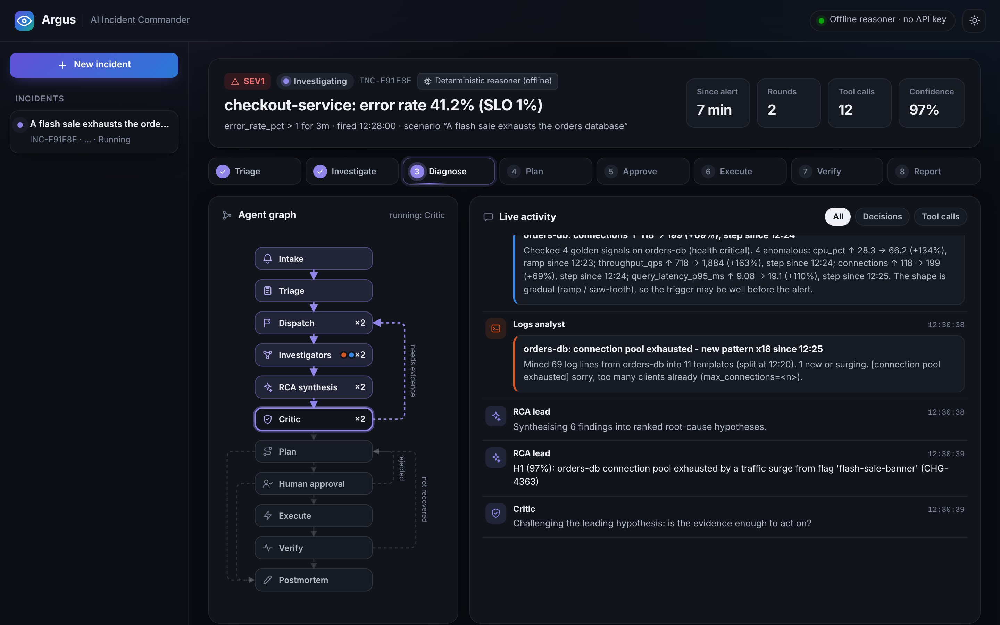
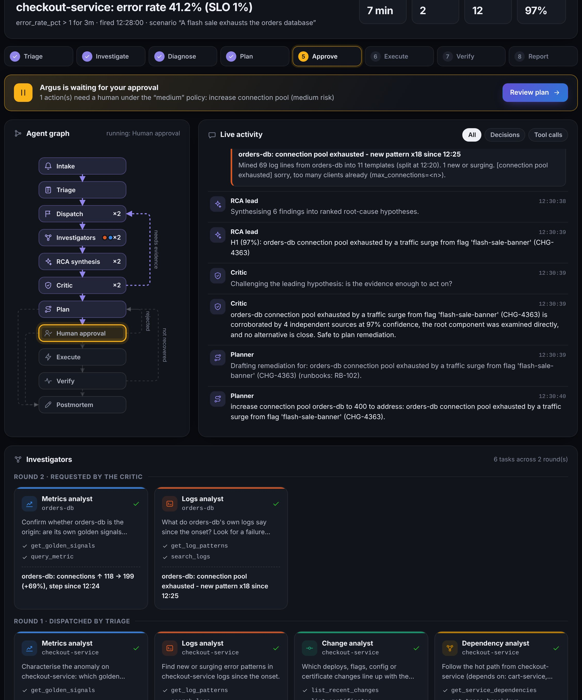
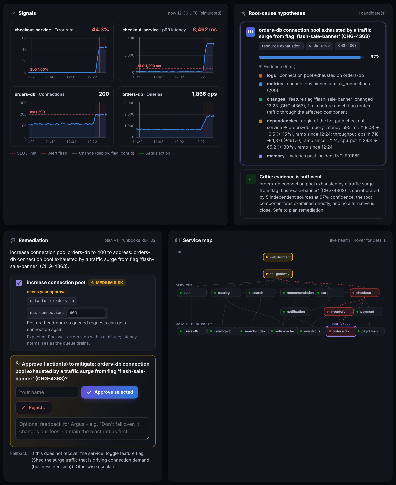
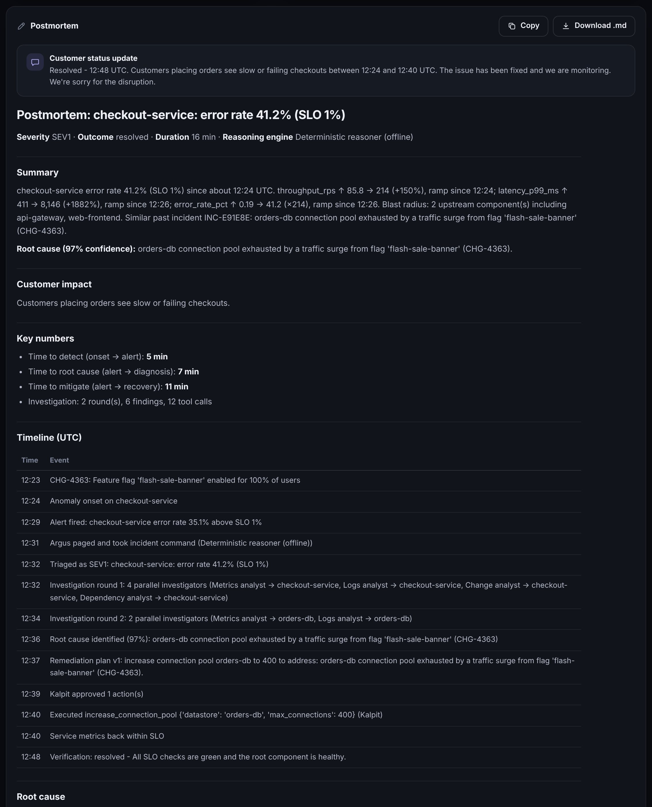
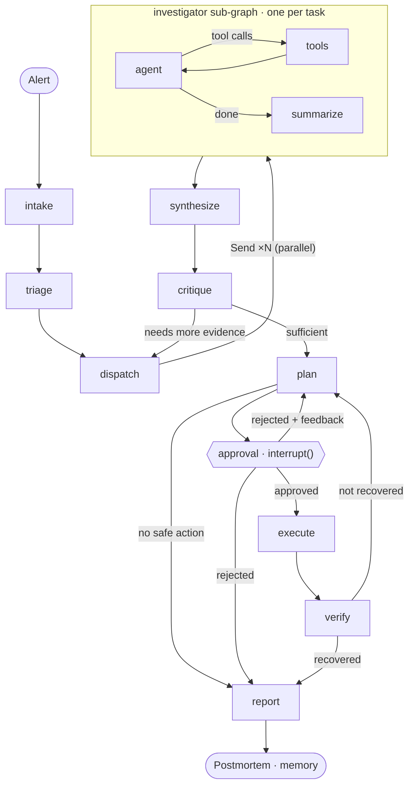

<div align="center">



# Argus — AI Incident Commander

**An agentic SRE built with LangGraph + LangChain.**
Parallel investigators dig through metrics, logs, changes and traces; a critic challenges every
conclusion; risky fixes wait for a human; and nothing is called "resolved" until the telemetry says so.

`LangGraph 1.2` · `LangChain 1.x` · `Claude Opus 5.5` · `FastAPI` · `SSE` · `zero-build web UI` · `runs offline`

### [Website](https://kalpitphogat.github.io/argus-incident-commander/) &nbsp;·&nbsp; [▶ Live demo](https://kalpitphogat.github.io/argus-incident-commander/demo/)

[](https://codespaces.new/kalpitphogat/argus-incident-commander)
&nbsp; [](https://github.com/kalpitphogat/argus-incident-commander/actions/workflows/ci.yml)
&nbsp; [](https://github.com/kalpitphogat/argus-incident-commander/actions/workflows/pages.yml)

</div>

---

## Why Argus

When production breaks at 3 a.m., an on-call engineer runs the same loop every time: *triage → look at
the golden signals → grep the logs → check what changed → follow the dependency that's slow → form a
hypothesis → challenge it → fix → verify → write the postmortem.* That loop is exactly what LangGraph is
good at: explicit state, parallel branches, cycles, durable pauses for humans.

Argus is that loop as an agent graph, wrapped in a "mission control" UI you can actually use:

- 🔎 **Four specialist investigators run in parallel** (`Send` fan-out), each a tool-calling sub-graph.
- 🧠 **An RCA lead ranks hypotheses; a critic sends investigators back** until the root component has been examined directly.
- ✋ **A human approval gate** (`interrupt()`) before any medium/high-risk action — approve, edit parameters, or reject with feedback.
- 🔁 **Closed-loop remediation**: actions change the system, a verifier watches the SLOs, temporary fixes are caught and Argus re-plans.
- 📝 **Blameless postmortem + customer status update**, written automatically.
- 💾 **Durable and resumable** (SQLite checkpoints) and **learns from history** (LangGraph `Store`).
- 🔌 **Runs with zero API keys**: a deterministic reasoner drives the same graph and tools; with a key it reasons with Claude and falls back per step if the provider fails.

| Live investigation | Human approval |
|---|---|
|  |  |

| Evidence, hypotheses, plan and blast radius | Verified recovery + postmortem |
|---|---|
|  |  |

---

## Ideas borrowed from the best LangGraph projects

I surveyed popular open-source agentic projects and took one proven idea from each:

| Project | Idea taken | Where it lives in Argus |
|---|---|---|
| [LangChain **open_deep_research**](https://github.com/langchain-ai/open_deep_research) | Supervisor delegates to parallel researcher sub-graphs, each **compresses** its work before returning | `dispatch → Send → investigate` sub-graph → `Finding` |
| [Google **gemini-fullstack-langgraph-quickstart**](https://github.com/google-gemini/gemini-fullstack-langgraph-quickstart) | A **reflection loop** that spots knowledge gaps and issues follow-up queries, bounded by max loops; a live activity timeline in the UI | `critique → dispatch` loop (`max_rounds`), live activity feed |
| [**TradingAgents**](https://github.com/TauricResearch/TradingAgents) / [**ai-hedge-fund**](https://github.com/virattt/ai-hedge-fund) | Specialist analysts → structured debate → risk review → decision | 4 analysts → RCA lead vs critic → risk-gated plan |
| [LangChain **Agent Inbox**](https://github.com/langchain-ai/agent-inbox) + [`interrupt()`](https://blog.langchain.com/making-it-easier-to-build-human-in-the-loop-agents-with-interrupt) | Approve / edit / reject with feedback; the graph waits in a checkpoint | `approval` node, approval panel, `POST /decision` |
| [AWS: stateful IT service-desk agent](https://aws.amazon.com/blogs/opensource/building-a-stateful-it-service-desk-agent-with-langgraph-on-amazon-eks/) | Interrupts + checkpointing map to tiered escalation | escalation paths, restart-safe resume |

---

## Architecture



| Node | What it does |
|---|---|
| `intake` | Opens the incident, builds (or rebuilds) the telemetry world, records the alert |
| `triage` | Severity, blast radius, customer impact, **recalls similar past incidents** from the store, plans round 1 |
| `dispatch` → `investigate` | Fans out one task per specialist with `Send`; each investigator is a sub-graph: *agent ⇄ tools → summarize* |
| `synthesize` | RCA lead merges findings into 1–4 ranked hypotheses with supporting / contradicting evidence |
| `critique` | Devil's advocate: is the root component examined directly? ≥ 2 independent sources? close alternative? → follow-up tasks or proceed |
| `plan` | Runbook-driven remediation (runbooks are Markdown with machine-readable action templates) |
| `approval` | `interrupt()` for every action at/above the risk policy; low-risk ones are auto-approved |
| `execute` | Idempotent actions against the control plane (`action_id` keys) |
| `verify` | Observes SLOs after the change; detects *temporary* fixes (e.g. memory still climbing) and partial mitigations |
| `report` | Postmortem (streamed) + status-page update; writes incident memory |

**Specialists and their tools** (`src/argus/tools.py`, all read-only — the model can never mutate production):

| Specialist | Tools |
|---|---|
| Metrics analyst | `get_golden_signals` (robust anomaly detection: onset, step/ramp/spike/saw-tooth), `query_metric` |
| Logs analyst | `get_log_patterns` (Drain-style template mining, new/surging patterns, failure signatures), `search_logs` |
| Change analyst | `list_recent_changes`, `get_deploy_history`, `list_certificates`, `check_vendor_status`, `list_feature_flags` |
| Dependency analyst | `get_service_dependencies`, `get_trace_breakdown` (follows the hot path), `check_vendor_status` |

Each tool returns `content_and_artifact`: concise text for the LLM, plus a structured artifact the
offline reasoner and the UI consume — so both engines see exactly the same evidence.

### LangGraph / LangChain features used

| Feature | Where |
|---|---|
| `StateGraph`, typed state with reducers (`Annotated[list, operator.add]`) | `graph.py` |
| Map-reduce with `Send`, compiled sub-graph as a node, `output_schema` | `dispatch`, `investigate` |
| Cycles with conditional edges (critic loop, re-plan loops) | `after_critique`, `after_approval`, `after_verify` |
| Human-in-the-loop: `interrupt()` + `Command(resume=…)` | `approval` node |
| Runtime context (`context_schema`) for per-run config | `RunContext` |
| Durable execution: `AsyncSqliteSaver`, resume after restart | `runner.py`, `test_paused_incident_survives_a_restart` |
| Long-term memory: `AsyncSqliteStore` / `BaseStore` | `memory.py` |
| Streaming: `custom` + `tasks` + `updates` modes, `subgraphs=True`, `get_stream_writer()` | `events.py`, `runner.py` |
| `RetryPolicy` on LLM nodes | `build_graph()` |
| `init_chat_model` (provider-agnostic), `bind_tools`, `with_structured_output(method="json_schema")`, `astream` | `brains/llm.py` |
| `@tool(response_format="content_and_artifact")` | `tools.py` |
| Custom `BaseRetriever` (BM25 over runbooks, no embeddings needed) | `knowledge/__init__.py` |
| LangGraph Studio / Platform entry point | `langgraph.json`, `studio.py` |

---

## Try it

**1. Website and live demo (nothing to install):**
[project website](https://kalpitphogat.github.io/argus-incident-commander/) ·
[live demo](https://kalpitphogat.github.io/argus-incident-commander/demo/)

Both are static and hosted on GitHub Pages. Pages can't run Python, so every incident on them is a
**recording of the real agent**: on each push, [`pages.yml`](.github/workflows/pages.yml) runs
`argus export-demo`, which drives the actual LangGraph through the same runner the server uses (offline
reasoner) and records every event, tool call, finding, hypothesis and the telemetry behind the charts.

- **The website** (`/`) replays three of those recordings in its hero console, quotes their real outcomes
  on the scenario cards, shows code excerpts read straight from `graph.py`, and publishes a chaos
  benchmark that the build measures on 100 fresh incidents (`--bench`). Nothing on it is hand-typed data.
- **The demo** (`/demo/`) is the full mission-control UI. At the approval step you pick a recorded branch:
  **approve**, or **reject with feedback** and watch Argus re-plan. Scenario cards on the website deep-link
  into it (`/demo/#/start/<scenario>`). Partial approvals, parameter edits and the Claude engine need the
  live agent (below).

**2. The full live agent on GitHub (Codespaces):**

1. Click **[Open in GitHub Codespaces](https://codespaces.new/kalpitphogat/argus-incident-commander)**
   (or **Code → Codespaces → +** on this repo).
2. Wait for the first-time setup (a few minutes: it installs Argus from `.devcontainer/devcontainer.json`).
3. The server starts on its own and the Argus UI opens in a new tab. If it doesn't, open the **Ports**
   panel and click the globe icon next to port **8000**.

To reason with Claude inside the codespace, add your key as a **Codespaces secret** named
`ANTHROPIC_API_KEY` (GitHub → *Settings → Codespaces → Secrets*), then restart the codespace. Without it,
Argus uses its offline reasoner. Forwarded ports are **private** by default; keep it that way when a key
is set, or anyone with the link could spend your API credits.

**Continuous integration:** every push runs [`ci.yml`](.github/workflows/ci.yml): the test suite on
Python 3.11 and 3.13, a 50-incident chaos evaluation that fails on any miss, and a Docker build plus a
smoke test that resolves an incident inside the container.

## Quickstart (local)

Requires Python 3.11+.

```bash
git clone https://github.com/kalpitphogat/argus-incident-commander.git && cd argus-incident-commander
python -m venv .venv && source .venv/bin/activate
pip install -e ".[dev]"
```

```bash
argus serve            # open http://127.0.0.1:8000
```

Pick a scenario (or **Chaos monkey**) and watch Argus work. No API key is needed: without one, Argus uses
its offline reasoner. To reason with Claude:

```bash
export ANTHROPIC_API_KEY=sk-ant-...      # then choose "Claude" (or "Auto") in the UI
```

**Terminal:**

```bash
argus run checkout-deploy-regression -v          # interactive approval in the terminal
```

```bash
argus run chaos --engine deterministic --policy never --yes
```

```bash
argus eval --n 100                               # accuracy on random, unseen faults
```

**Docker:**

```bash
docker compose up --build                        # http://localhost:8000, data in a volume
```

**LangGraph Studio:** `cp .env.example .env && langgraph dev` (uses `langgraph.json`; needs `pip install "langgraph-cli[inmem]"`), then start a run with input
`{"scenario_id": "flash-sale-pool-exhaustion"}` and resume the interrupt with `{"decision": "approve"}`.

### Configuration

| Variable | Default | Meaning |
|---|---|---|
| `ANTHROPIC_API_KEY` | – | Enables the Claude engine (`Auto` picks it when set) |
| `ARGUS_MODEL` | `anthropic:claude-opus-5-5` | Any `init_chat_model` id: `openai:…`, `google_genai:…`, `ollama:…` (install the extra) |
| `ARGUS_DATA_DIR` | `.argus` | SQLite checkpoints + incident memory |
| `ARGUS_API_TOKEN` | – | If set, every `POST` requires `Authorization: Bearer <token>` |
| `LANGSMITH_TRACING` / `LANGSMITH_API_KEY` | – | Trace every run in LangSmith |

Per run (UI or API): reasoning engine, **approval policy** (`low` = approve everything, `medium` =
medium+high risk, `high`, `never` = autonomous), playback pace, max investigation rounds.

### How the LLM is used (Claude)

- Investigators: tool calling with `bind_tools`, effort **low** (fast sub-agents); every tool call streams to the UI.
- Triage, summaries, postmortem: effort **medium**. RCA synthesis, critique, planning: effort **high**.
- Every decision is a **native structured output** (`output_config.format`), validated by Pydantic.
- Server-side **refusal fallbacks** (`fallbacks: "default"`) and top-level **prompt caching** are enabled; no sampling parameters are sent.
- **Guardrails** don't trust the model: action names and parameters are validated against the control-plane catalog, risk can only be *raised* above the catalog floor (a model calling a rollback "low risk" still triggers approval), and model-supplied timestamps are parsed defensively.
- **Graceful degradation**: any failed LLM step falls back to the deterministic reasoner for that step and says so in the activity feed.

---

## Scenarios

Every incident runs against a freshly generated, seeded production estate ("Lumen Shop": 11 services,
6 datastores, a third-party payment API) with realistic metrics, logs, traces, change history, flags,
certificates and red-herring changes. Actions really change the simulation, so verification is real.

| Scenario | What broke | What Argus has to figure out |
|---|---|---|
| Checkout slows after a deploy | N+1 query regression in `checkout-service 2.14.0` | Is `orders-db` the cause or a victim? (2 rounds) → rollback |
| Flash sale exhausts the orders DB | Feature flag drives 2.6× traffic past `max_connections` | Link the flag to the pool exhaustion → raise the pool (never scale callers!) |
| Homepage 502s (crash loop) | Memory leak in `recommendation-service 5.2.0` | Gradual failure: widen the change window; a restart is only temporary → rollback |
| Card payments failing | Third-party PayRail outage | No internal change; confirm vendor status → failover (or circuit breaker first) |
| Nobody can log in | Expired mTLS client certificate | The DB is healthy, the *client* is broken → rotate the certificate |
| Add-to-cart failing | Unhandled exception in a release | Self-inflicted errors → rollback |
| **Chaos monkey** | A random fault in a random component (20+ variants) | Anything |

### Evaluation

`argus eval --n 100 --start 1000` — 100 random chaos incidents, offline reasoner, autonomous policy:

| Fault family | Incidents | Root cause correct | Recovered |
|---|---|---|---|
| bad_deploy | 36 | 100% | 100% |
| cert_expiry | 13 | 100% | 100% |
| external_outage | 24 | 100% | 100% |
| memory_leak | 9 | 100% | 100% |
| pool_exhaustion | 18 | 100% | 100% |

These numbers are on the simulator's fault families (the reasoner never sees the injected fault — only
tool outputs). They show the pipeline is data-driven and robust to random targets and red herrings; they
are not a claim about accuracy on real production systems. The same harness works with
`--engine llm` to evaluate a model. The website re-runs it (seeds 1000–1099) on every deploy and publishes
whatever it measures, misses included.

---

## API

| Method | Path | |
|---|---|---|
| `POST` | `/api/incidents` | Start: `{"scenario": "chaos", "reasoning": "auto", "approval_policy": "medium"}` |
| `GET` | `/api/incidents/{id}/events` | Server-Sent Events, replayable (`Last-Event-ID`) |
| `POST` | `/api/incidents/{id}/decision` | `{"decision": "approve", "approved_ids": ["A1.1"], "edits": {"A1.1": {"max_connections": 600}}, "by": "you"}` or `{"decision": "reject", "feedback": "…"}` |
| `GET` | `/api/incidents/{id}` | Snapshot (works after a server restart) |
| `GET` | `/api/incidents/{id}/telemetry?components=a,b` | Series + alert/change/action markers |
| `GET` | `/api/incidents/{id}/postmortem.md` | Download the postmortem |
| `POST` | `/api/webhooks/alertmanager` | Prometheus Alertmanager webhook → incidents |
| `GET` | `/api/graph`, `/api/topology`, `/api/scenarios`, `/api/health` | Metadata |

```bash
curl -X POST localhost:8000/api/webhooks/alertmanager -H 'Content-Type: application/json' \
  -d '{"alerts":[{"status":"firing","labels":{"alertname":"HighErrorRate","service":"payment-service"}}]}'
```

---

## Taking it to production

Argus separates *reasoning* (graph + brains) from *the world* (telemetry and control plane). The
simulator is the default backend; connecting real systems means re-implementing the tool functions and
`apply_action` against your stack — the graph, prompts, UI and API stay the same:

| Concern | Simulator today | Real-world adapter |
|---|---|---|
| Metrics | `World.series` | Prometheus `query_range`, Datadog, CloudWatch |
| Logs | `World.logs` | Loki, Elasticsearch/OpenSearch, Datadog Logs |
| Traces | `World.trace_breakdown` | Tempo / Jaeger / Datadog APM span aggregates |
| Changes | `World.changes` | GitHub/Argo CD deployments, LaunchDarkly audit log, Terraform runs |
| Actions | `World.apply_action` | Kubernetes API, Argo Rollouts, feature-flag API, cert-manager |
| Approvals | Web UI | Same API from Slack / PagerDuty buttons |
| Persistence | SQLite | `langgraph-checkpoint-postgres` + Postgres store |

Production checklist: put the API behind SSO (set `ARGUS_API_TOKEN` at minimum), keep mutating actions
behind the approval policy, enable LangSmith tracing, and run `argus eval` (with `--engine llm`) in CI
before changing prompts or models.

---

## Project structure

```
argus-incident-commander/
├── src/argus/
│   ├── graph.py            # the LangGraph: nodes, sub-graph, routing, build_graph()
│   ├── brains/             # reasoning engines: llm.py (Claude), deterministic.py, prompts.py, fallback wrapper
│   ├── tools.py            # read-only LangChain tools (content + artifact)
│   ├── analysis.py         # anomaly detection, log-template mining, change correlation
│   ├── knowledge/          # runbooks (Markdown + action templates) + BM25 retriever
│   ├── sim/                # seeded production-estate simulator: topology, faults, world, scenarios
│   ├── runner.py           # background runs, replayable event log, resume
│   ├── server.py           # FastAPI: REST + SSE + webhook
│   ├── cli.py              # argus serve | run | scenarios | eval | export-demo
│   ├── evaluate.py         # chaos evaluation (argus eval, CI and the published benchmark)
│   ├── demo.py             # records real runs into the static GitHub Pages demo
│   ├── sitegen.py          # builds the website from those recordings + the benchmark
│   ├── site/               # website template, CSS, JS (hero replay), self-hosted fonts, images
│   ├── studio.py           # LangGraph Studio / Platform entry point
│   └── web/                # zero-build UI: vanilla JS modules + SVG charts, light & dark (demo.js = replay)
├── tests/                  # 131 tests incl. a mock Anthropic API for the LLM path
├── .github/workflows/      # ci.yml (tests, eval, Docker) · pages.yml (website + demo)
├── .devcontainer/          # GitHub Codespaces
├── langgraph.json  Dockerfile  docker-compose.yml  pyproject.toml
```

## Tests

```bash
pytest -q        # ~17 s
```

Covers: simulator determinism and causality (wrong fixes don't help, history is never rewritten), anomaly
detection and log mining, every curated scenario end-to-end, 40 random chaos incidents, every human-in-the-
loop path (rejection with feedback, partial approval → temporary fix detected → real fix re-proposed,
escalation, autonomous mode, auto-approval of low-risk actions), incident memory, **resuming a paused
incident after a restart from SQLite alone**, the HTTP API and SSE replay, webhook auth, and the **LLM path**
end-to-end through `langchain-anthropic` against a local mock of the Messages API that rejects sampling
parameters, forced tool choice, missing effort, deprecated fields, and replays without thinking blocks, and the
demo exporter (both recorded branches, monotonic clock, site assembly) and the website generator (replay
scripts, syntax highlighting round-trips, the graph diagram matching the compiled graph, the benchmark).

> **What has been verified:** all of the above, on Python 3.11 and 3.13, plus the Docker image, which CI
> builds and smoke-tests (an incident is resolved inside the container) on every push. The LLM engine
> was exercised against that protocol-accurate mock, not against the live Claude API (no key was
> available). Run `argus eval --engine llm` with a key to measure a real model.

## Safety notes

- The LLM only gets **read-only** tools; actions are executed by the graph after the approval gate.
- Risk levels are floored by the control-plane catalog; parameters are validated before execution.
- Actions are idempotent (`action_id`), so a retried node never double-applies a change.
- All model output rendered in the UI is HTML-escaped (the Markdown renderer escapes first).
